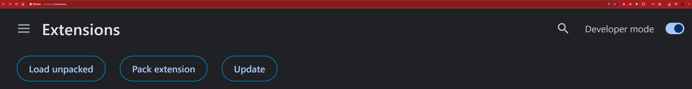

# Rumble Chatters Goal Monitor — Version 3.0.1

A Chrome extension that helps live Rumble creators track the two monthly Creator Program metrics used by Rumble Chatters:

- **Total unique chatters this month**
- **Hours watched this month**

The extension reads these metrics from the creator's own Rumble earnings dashboard, checks whether the creator is currently live using their private Rumble Livestreaming API URL, and sends only the derived status needed to power the shared support list.

Service information:

```text
https://chatters.streemrz.com
```

---

## What's new in Version 3

Version 3 expands Rumble Chatters from a single chatter goal into a dual-goal monitor.

### Version 3.0.1 highlights

- Tracks **Unique Chatters** and **Watch Hours**.
- Correctly targets the exact Rumble metric labelled **Hours watched this month**.
- Ignores other hour-based metrics such as **Hours streamed from Rumble Studio**.
- Understands compact Rumble values such as:
  - `5.41K` → `5410`
  - `1.2K` → `1200`
  - `1.5M` → `1500000`
- Preserves normal decimal values such as `381.3`.
- Shows the current creator in the shared live list with a **YOU** marker.
- Shows exactly which goal or goals are still required.
- Refreshes dashboard metrics every **10 minutes while live only**.
- Resets both monthly metrics at the beginning of each Rumble month.
- Keeps Version 2 clients compatible with the shared service.
- Version 1 is retired.

<!-- Screenshot suggestion:

-->

---

# Tracked Creator Program goals

Rumble Chatters currently tracks these two values from the Rumble Creator Program section of the earnings dashboard.

## 1. Total unique chatters this month

Example:

```text
42 / 75 chatters
```

In this example:

```text
Current: 42
Goal:    75
Needed:  33
```

The current target is:

```text
75 unique chatters
```

---

## 2. Hours watched this month

Example:

```text
381.3 / 500 hours
```

In this example:

```text
Current: 381.3
Goal:    500
Needed:  118.7 hours
```

The current target is:

```text
500 watch hours
```

Rumble may display larger values using compact notation.

For example:

```text
5.41K / 500 hours
```

Rumble Chatters converts this to:

```text
5410 / 500 hours
```

so the goal is correctly recognised as achieved.

Rumble notes on the dashboard that **Hours watched may take up to 24 hours to fully process**, so the displayed Watch Hours value may lag behind current activity.

---

# Which creators appear in the live support list?

A creator is shown when:

```text
The creator is currently live
AND
the browser installation is authenticated and enrolled
AND
scheduled reporting is enabled
AND
at least one tracked goal is still outstanding
```

The two goals are evaluated independently.

| Chatters | Watch Hours | Result |
|---|---|---|
| Below goal | Below goal | Show both reasons |
| Below goal | Goal achieved | Show Chatters only |
| Goal achieved | Below goal | Show Watch Hours only |
| Goal achieved | Goal achieved | Remove from support list |

### Example — both goals needed

```text
Needs support

33 chatters needed
118.7 watch hours needed
```

### Example — Chatters only

```text
Needs support

33 chatters needed
```

### Example — Watch Hours only

```text
Needs support

118.7 watch hours needed
```

Once both goals are achieved, the creator no longer appears in the support list.

---

# The YOU confidence check

Version 3 deliberately shows your own live stream in the shared list when you still need support.

Your own card is marked:

```text
YOU
```

This provides an immediate confidence check that:

- your extension is reporting successfully;
- your live status has been detected;
- your current metrics were accepted;
- the backend considers you eligible for the support list; and
- other Rumble Chatters users can see your stream.

This is intentional behaviour. Version 2 previously filtered the current user out of the list.

<!-- Screenshot suggestion:

-->

---

# Automatic metric refresh

Version 3 checks for updates every:

```text
10 minutes
```

The automatic dashboard capture only runs while the Rumble Livestreaming API reports that the creator is live.

## When offline

```text
Check Rumble live status
        ↓
Offline
        ↓
Report offline state
        ↓
Do not open the earnings dashboard
```

## When live

```text
Check Rumble live status
        ↓
Live
        ↓
Load the Rumble earnings dashboard
        ↓
Read Chatters + Watch Hours
        ↓
Send the signed status report
        ↓
Close the temporary dashboard capture
```

If the Rumble earnings dashboard is already open, the extension can reuse the available dashboard page.

When another page is required, Chrome does not provide a true invisible authenticated-tab API. Rumble Chatters therefore uses a short-lived, minimised/unfocused dashboard capture and closes it after the metrics are read.

---

# Installation

## Requirements

Before installing, you need:

- Google Chrome or another compatible Chromium browser that supports unpacked Manifest V3 extensions.
- A Streemrz.com account.
- Access to your own Rumble earnings dashboard.
- Your private Rumble Livestreaming API URL.

Your Rumble Livestreaming API URL must:

- use HTTPS;
- be hosted on `rumble.com`; and
- belong to you.

---

## Fresh installation

### 1. Download and extract the extension

Download the latest **Version 3.0.1 Full** package from the project release page.

Extract it to a permanent folder.

Do not load the extension from a temporary extraction folder that may later be deleted or moved. Chrome needs continued access to the folder containing `manifest.json`.

### 2. Open Chrome Extensions

Open:

```text
chrome://extensions
```

Then:

1. Enable **Developer mode**.
2. Click **Load unpacked**.
3. Select the extracted folder containing `manifest.json`.
4. Pin **Rumble Chatters** to the Chrome toolbar.

<!-- Screenshot suggestion:

-->

### 3. Open Options

Click the extension icon and select:

```text
Open Options
```

### 4. Authenticate with Streemrz

Click:

```text
Authenticate with Streemrz
```

The extension opens the normal Streemrz.com authentication flow.

- If you are already signed in to Streemrz, the existing browser session can be reused.
- Otherwise, Streemrz asks for your username, password and configured MFA.
- Streemrz then displays the Rumble Chatters permission screen.
- Press **Authorize** to connect the browser installation.

The extension does **not** receive your Streemrz password or MFA response.

<!-- Screenshot suggestion:


-->

After successful authentication, Options should show the Streemrz account as authenticated and the secure device connection as enrolled.

<!-- Screenshot suggestion:

-->

### 5. Add the Rumble Livestreaming API URL

Paste your private Rumble Livestreaming API URL into:

```text
Rumble Livestreaming API URL
```

This URL stays inside your browser extension and is not uploaded to the Rumble Chatters backend.

<!-- Screenshot suggestion:

-->

### 6. Configure optional settings

#### Display name override

Leave blank to use the name returned by the Rumble API, or enter your preferred display name.

#### Scheduled reporting

Keep scheduled reporting enabled for normal use.

Version 3 uses a **10-minute interval**.

The extension:

1. checks whether you are live;
2. obtains the current dashboard metrics when required;
3. creates a securely signed status report; and
4. sends only the derived status required by the shared service.

#### Goal-achieved audio

You may select a local MP3, WAV or OGG file to play when your monthly Rumble Chatters goals are achieved.

The audio file remains local to the browser extension.

Recommended settings:

- clip length: 1–5 seconds;
- starting volume: 40–60%; and
- **Play once per stream/month** enabled.

In Version 3, the overall goal is achieved when:

```text
Chatters >= 75
AND
Watch Hours >= 500
```

<!-- Screenshot suggestion:

-->

### 7. Save and test

Click:

```text
Save & Test
```

A successful result confirms that the configuration is valid and the secure connection is working.

### 8. Open the Rumble earnings dashboard

Open:

```text
https://rumble.com/account/dashboard?type=earnings&interval=30
```

Allow the page to load completely, then open Rumble Chatters and press refresh.

The popup should show both:

```text
Unique Chatters
x / 75
```

and:

```text
Watch Hours
x / 500
```

<!-- Screenshot suggestion:

-->

---

# Updating an existing installation

## Updating from Version 3.0.0 to Version 3.0.1

Use the Version 3.0.1 differential/hotfix package.

1. Back up your existing extension folder.
2. Extract the Version 3.0.1 patch.
3. Copy the updated files over the existing extension.
4. Do **not** uninstall the extension.
5. Open `chrome://extensions`.
6. Press **Reload** on Rumble Chatters.
7. Reload the Rumble earnings dashboard.
8. Open Rumble Chatters and press refresh.

Version 3.0.1 clears the previously cached **Watch Hours** value once so that an incorrect Version 3.0.0 Hours Streamed capture cannot remain as the monthly maximum.

It does **not** clear:

- your Chatters value;
- Streemrz authentication;
- browser installation identity;
- non-extractable device key;
- Rumble API URL;
- selected audio; or
- normal extension preferences.

---

## Updating from Version 2 to Version 3

When upgrading an existing Version 2 installation:

1. Back up the current extension folder.
2. Extract the Version 3 full/differential update as supplied.
3. Copy the new files over the existing extension folder.
4. Do **not** uninstall the extension.
5. Open `chrome://extensions`.
6. Press **Reload**.
7. Open Options.
8. Confirm your existing Streemrz authentication.
9. Press **Save & Test**.
10. Open the Rumble earnings dashboard and refresh once.

Not uninstalling helps preserve your:

- installation identity;
- non-extractable private key;
- Streemrz account binding;
- Rumble API URL;
- selected audio; and
- extension preferences.

---

# Popup behaviour

## Open Dashboard

Opens the Rumble earnings dashboard used to read the Creator Program metrics.

## Open Options

Opens authentication and extension configuration.

## Refresh

Runs an immediate local metric check and status report.

---

# Your goals

The popup shows separate progress information for:

## Unique Chatters

Example:

```text
42 / 75
33 chatters needed
56%
```

## Watch Hours

Example:

```text
381.3 / 500
118.7 watch hours needed
76%
```

A value above the goal remains valid and is shown as achieved.

Example:

```text
5410 / 500
Goal achieved
100%+
```

---

# Monthly reset

Both tracked monthly metrics reset at:

```text
00:00 America/New_York
on the first day of each month
```

Using the `America/New_York` timezone automatically handles EST and EDT.

At the monthly boundary, Rumble Chatters resets the local monthly state for:

```text
Unique Chatters
Watch Hours
```

and obtains fresh values from the Rumble dashboard.

The extension also checks for a missed rollover when Chrome starts, the extension updates, scheduled reporting runs, or a new dashboard metric is captured.

A stale value from the previous month is rejected rather than restoring the old monthly result.

---

# Version compatibility

The shared Rumble Chatters service currently supports:

| Extension generation | Status | Metrics |
|---|---|---|
| Version 1 | Retired | Unsupported |
| Version 2 | Supported | Unique Chatters |
| Version 3 | Full support | Unique Chatters + Watch Hours |

Version 2 users can continue using the service.

However, Version 2 does not understand Watch Hours. A Version 2 user may therefore not see a creator whose Chatters goal is already achieved but whose Watch Hours goal is still outstanding.

Version 3 is recommended for the complete support list.

---

# Privacy and security

## Data that remains local

The following remains in your browser:

- private Rumble Livestreaming API URL;
- Rumble API key contained in that URL;
- local goal-achieved audio file;
- non-extractable device private key;
- extension preferences;
- Rumble dashboard cookies; and
- Rumble browser session data.

## Streemrz authentication

The extension never receives or stores your:

- Streemrz password;
- MFA response; or
- Streemrz login session cookie.

Authentication is performed through Streemrz.com.

## Data used by the shared service

The shared service stores only the account, device and derived reporting information required to authenticate installations and operate the support list.

This may include:

- Streemrz user ID and username;
- browser installation and extension identifiers;
- device public-key information;
- last reporting time;
- current derived live status;
- current derived Chatters value; and
- current derived Watch Hours value.

The shared service does **not** store your:

- private Rumble Livestreaming API URL;
- Rumble API key;
- Rumble password;
- Streemrz password;
- MFA code;
- Rumble dashboard cookies; or
- browser session data.

## Device security

Each browser installation has its own cryptographic device identity.

The private key is generated locally and stored as non-extractable.

Reports are signed so that the service can reject invalid, expired or replayed requests.

There is no permanent shared API secret embedded in Version 3 of the extension.

---

# Troubleshooting

## Watch Hours shows Hours Streamed instead

Upgrade to **Version 3.0.1 or later**.

Version 3.0.1 specifically anchors the parser to:

```text
Hours watched this month
```

and ignores other Creator Program hour metrics such as:

```text
Hours streamed from Rumble Studio this month
```

After upgrading:

1. reload the extension from `chrome://extensions`;
2. reload the Rumble earnings dashboard; and
3. press refresh in Rumble Chatters.

Version 3.0.1 also clears the old cached Watch Hours value once during upgrade.

---

## A Watch Hours value contains K

This is normal Rumble formatting.

Examples:

```text
5.41K = 5410
1.2K  = 1200
```

The extension automatically converts compact values before comparing them with the 500-hour goal.

---

## Watch Hours has decimals

Decimals are supported.

Example:

```text
381.3 / 500
```

is treated as:

```text
381.3 current watch hours
118.7 remaining watch hours
```

---

## The extension shows no metrics

Open:

```text
https://rumble.com/account/dashboard?type=earnings&interval=30
```

Wait until the Creator Program section has loaded completely, then press refresh.

The page should contain both:

```text
Total unique chatters this month
```

and:

```text
Hours watched this month
```

A future Rumble interface change may require an extension parser update.

---

## I am live but I do not see myself in the list

Confirm:

- your Rumble Livestreaming API URL is configured;
- Streemrz authentication is complete;
- the secure device connection is enrolled;
- scheduled reporting is enabled;
- Rumble currently reports you as live;
- at least one of the two goals is still outstanding; and
- a recent refresh or scheduled report has completed.

If both goals are achieved, you are intentionally removed from the support list.

---

## I see myself with a YOU badge

That is expected.

It confirms your current live report is visible through the shared support-list workflow.

---

## The live support list is empty

This normally means no currently reporting creator is both:

```text
live
AND
still below at least one goal
```

---

## Authentication was cancelled

Close the cancelled authentication tab and press **Authenticate with Streemrz** again.

Each attempt creates a new short-lived authentication session.

---

## Authentication does not complete

Try:

1. close the failed authentication page;
2. return to Rumble Chatters Options;
3. press **Authenticate with Streemrz** again;
4. make sure cookies and pop-ups are not blocked for `streemrz.com`;
5. temporarily disable an ad blocker/privacy extension for the authentication page if necessary; and
6. press **Authorize** on the Streemrz consent screen.

Never paste passwords, MFA codes, OAuth callback URLs, or your private Rumble API URL into a public support issue.

---

## Goal audio does not play

Confirm:

- an audio file is selected;
- volume is above zero;
- goal-achieved audio is enabled;
- both monthly goals are achieved; and
- the clip has not already played for the same stream/month.

Use **Test Audio** in Options to verify the selected file.

---

# Suggested screenshots

Store public screenshots under:

```text
docs/images/
```

Suggested filenames:

```text
01-chrome-load-unpacked.png
02-version-3-popup.png
03-you-confidence-check.png
04-authenticate-with-streemrz.png
05-streemrz-consent.png
06-authenticated-and-enrolled.png
07-rumble-api-configuration.png
08-goal-audio-settings.png
09-dual-metrics.png
10-both-goals-needed.png
11-chatters-only-needed.png
12-watch-hours-only-needed.png
```

Before publishing screenshots, hide or crop:

- your private Rumble Livestreaming API URL;
- API keys;
- activation/recovery codes;
- OAuth callback URLs containing temporary `code` or `state` values;
- browser credential identifiers;
- email addresses or other personal information you do not intend to publish.

---

# Version history

## Version 3.0.1

- Fixed Watch Hours parsing so it cannot be confused with Hours Streamed.
- Added `K` and `M` compact-number conversion.
- Preserved decimal Watch Hours values.
- Clears the incorrect Version 3.0.0 Watch Hours cache once after upgrade.

## Version 3.0.0

- Added **Hours watched this month** as the second tracked goal.
- Added dual-goal live-list reasons.
- Added the **YOU** confidence-check marker.
- Changed automatic reporting to a 10-minute interval.
- Added live-only automatic dashboard metric capture.
- Extended monthly rollover handling to both metrics.
- Updated the extension footer to **Version 3**.

## Version 2

- Added Streemrz account authentication.
- Added secure per-browser device identity.
- Removed the permanent shared API secret.
- Added first-of-month New York reset and rescan.
- Added local goal-achieved audio.
- Added **Open Dashboard** and **Open Options** controls.

## Version 1

Version 1 is retired and no longer supported by the shared Rumble Chatters service.

---

# Streemrz

Project and service information:

```text
https://streemrz.com
```
